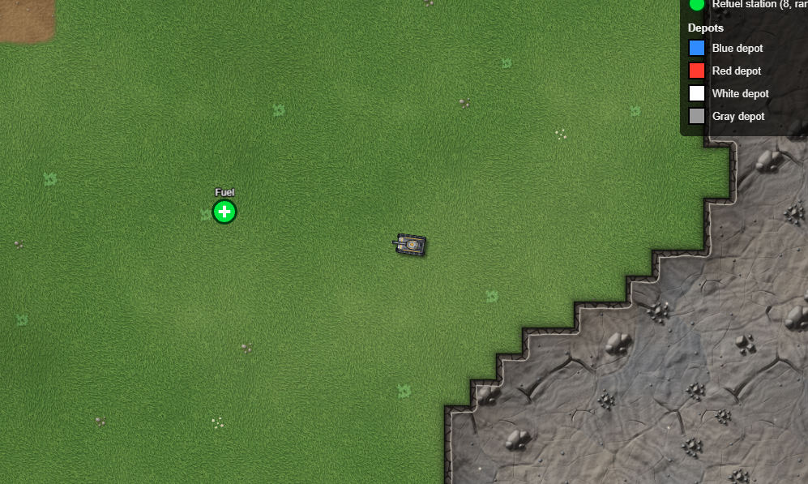
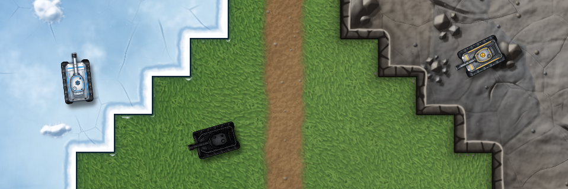
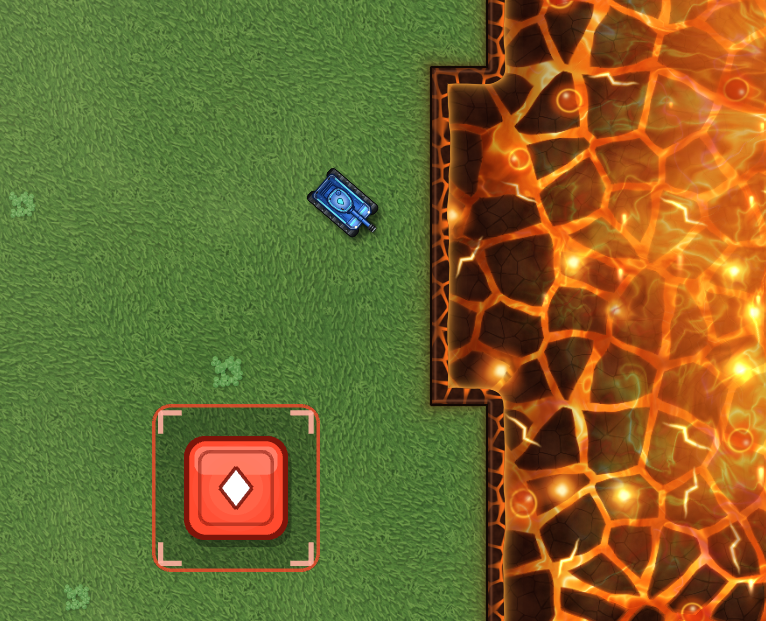

# Tank Battle

[Mermaid Diagram](tank_battle_mermaid_diagram.md)

## Description

Several agents were able to produce the following screenshots for Tank Battle. The goal of Tank Battle is to gather cells from other depots and return them to your depot.

It is a multiplayer game which up to 20 players can play at one time.

## Screenshots

Below are a few screenshots of various tanks in different environments.

**Image 1**: A tank heading to a refueling station

**Image 2**: Two element tanks (Ice and Rock) and an enemy tank (Wrecker)

**Image 3**: An element tank (water) approaching fire with a fire depot cell

## Video

In this video of Tank Battle, you will see the splash screen, the menu screen, and then a tank moving around the game. The tank has the ability to shoot, and the game currently has simple collision detection, meaning the tank cannot cross into other elements.

**Video 1**

<video src="tank_battle_example_video_Wave2.mp4" controls width="100%"></video>

[Watch Video 1: tank_battle_example_video_Wave2.mp4](tank_battle_example_video_Wave2.mp4)
