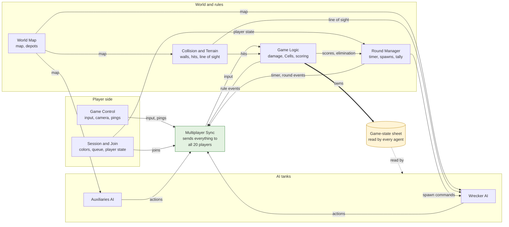
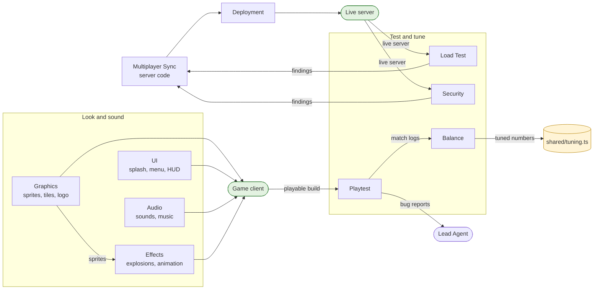

# Tank Battle: Build Agents, Roles and Data Flow

Twenty single-purpose agents build Tank Battle in seven waves, with no more than three running at once. Three short diagrams answer three questions: **when** each agent runs, **how the game server's pieces connect**, and **how the look, the server and the tests connect**.

## 1. When does each agent run?

The Lead Agent writes the briefs before every wave and checks the handoffs after it. Between waves, you test and approve before the next one starts. After Wave 3 you also test a playable slice.

```mermaid
flowchart LR
  Lead(["Lead Agent<br/>briefs before every wave,<br/>checks after every wave"])
  W0["<b>Wave 0</b><br/>Project Setup"]
  W1["<b>Wave 1</b><br/>Game Logic<br/>World Map<br/>Game Control"]
  W2["<b>Wave 2</b><br/>Collision and Terrain<br/>Round Manager<br/>Session and Join"]
  W3["<b>Wave 3</b><br/>Multiplayer Sync<br/>Wrecker AI<br/>Auxiliaries AI"]
  W4["<b>Wave 4</b><br/>Deployment<br/>UI<br/>Graphics"]
  W5["<b>Wave 5</b><br/>Audio<br/>Effects<br/>Security"]
  W6["<b>Wave 6</b><br/>Playtest<br/>Balance<br/>Load Test"]

  Lead -.-> W0
  W0 -->|"you approve"| W1
  W1 -->|"you approve"| W2
  W2 -->|"you approve"| W3
  W3 -->|"you test the slice"| W4
  W4 -->|"you approve"| W5
  W5 -->|"you approve"| W6

  classDef wave fill:#eef3fb,stroke:#3b6ea8
  class W0,W1,W2,W3,W4,W5,W6 wave
```

## 2. How do the game server's pieces connect?

This is the heart of the game: rules, map, rounds and AI feeding one sync layer that talks to all 20 players. The game-state sheet is the shared contract that Game Logic owns and every agent reads.

## 3. How do the look, the server and the tests connect?

The art, screens and sound all land in the game client. The server code becomes the live server. Then the test agents check both and send their findings back.

## What each agent does, in one line

| Agent | Its one job |
| --- | --- |
| Project Setup | Builds the project scaffold, shared types, and the Splash, Menu, and game scene order |
| Game Logic | Damage, Cells, depots, refueling, elimination, and scoring |
| World Map | The scrolling map, depots, stations, and depot HP |
| Game Control | Input, aiming, the camera, and ping keys |
| Collision and Terrain | Element walls, shell hits, and line of sight |
| Round Manager | The round timer, Wrecker spawns, tally, and practice mode |
| Session and Join | Color pick, the 20-player cap, queue, and the player state table |
| Multiplayer Sync | The 20-player netcode that sends everything to every player |
| Wrecker AI | Black tanks that roam and hunt the Cell leader |
| Auxiliaries AI | Team-color tanks that defend their depot |
| Deployment | The persistent online game server |
| UI | Splash, menu, HUD, hints, spectator view, and pings |
| Graphics | Tanks, Cells, depots, tiles, logo, and menu art |
| Audio | Sound effects, splash music, and menu music |
| Effects | Explosions and animated terrain |
| Security | Audits the server for cheating and bad input |
| Playtest | Scripted matches and bug reports |
| Balance | Tunes the numbers in the tuning file |
| Load Test | Simulates 20 players against the server |
| Lead | Writes briefs before and checks handoffs after every wave |