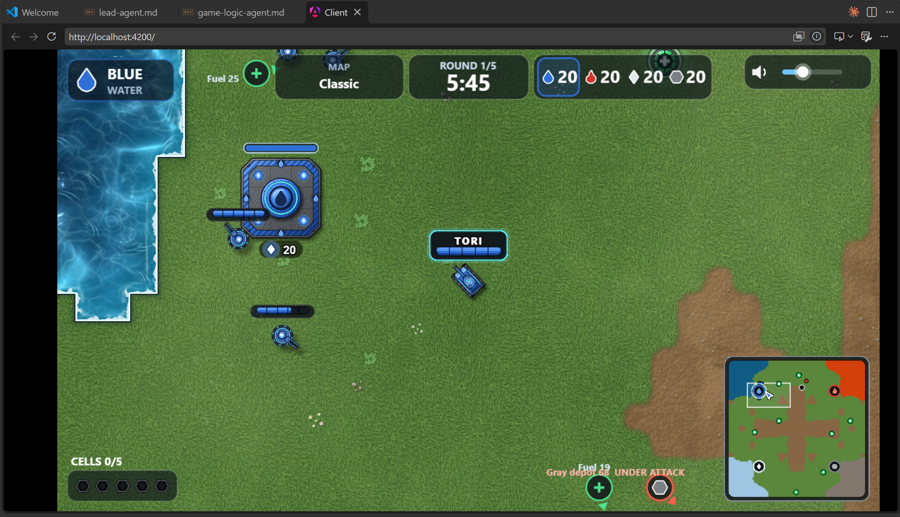

# Tank Battle – Assignment 05

## Agent Summaries

### Lead Agent
The Lead Agent coordinates the Tank Battle build between waves by writing one brief per agent, reading their handoff notes, and checking that their pieces and interfaces fit together. It never writes game code, and it logs conflicts and decisions so each fix goes to the agent that owns it.

### Game Logic Agent
The Game Logic Agent writes the server-side rules engine for Tank Battle, covering energy bars, 3-hit damage, Cell carrying and storing, depot HP, refueling, elimination, and round scoring. It also owns the shared game-state schema in `shared/game-state.ts`, which the other agents rely on.

## Notes

The lead-agent reads the GDD

The agent recommended an minimap in order to follow your tank around the game and to see where your enemy is located also

## Image

