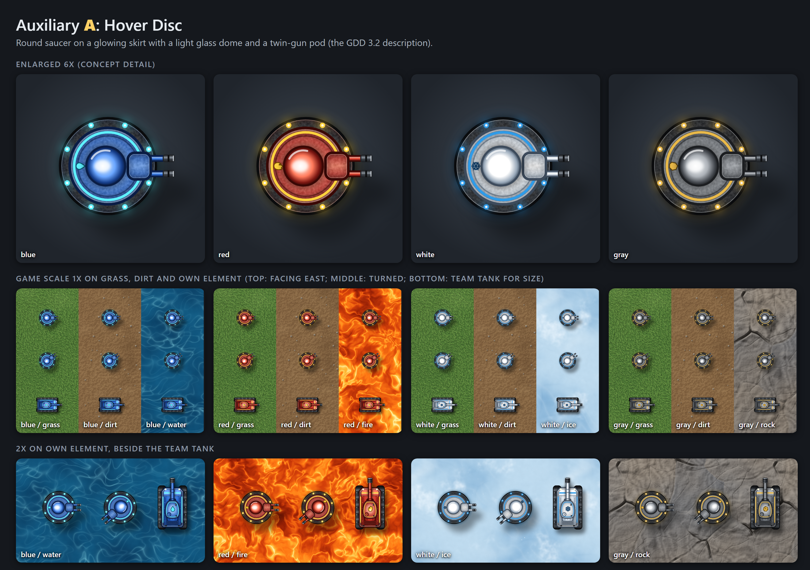
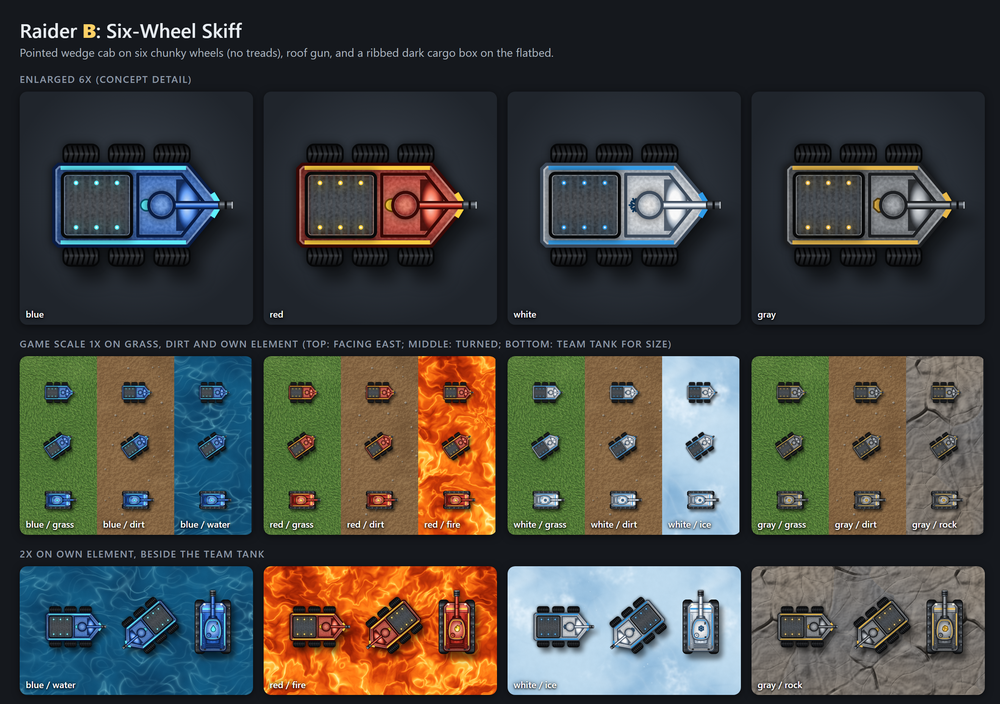
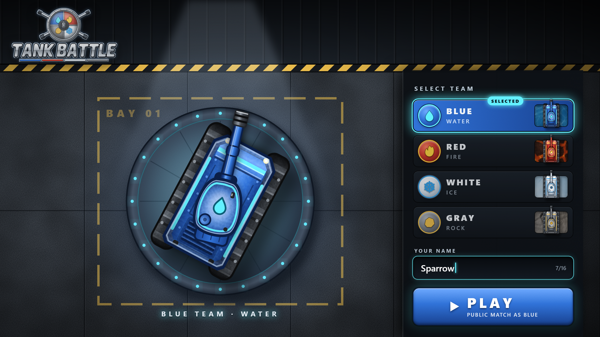

# Look and Feel Loop (Generator → Evaluator → Refiner)

A self-correcting check that every art, effects and UI task passes before it reaches the user's gate. It enforces the rules in `docs/art-rubric.md`. The user's `approved <task ID>` is still required afterward.

## The loop

```
          ┌─────────────────────────────────────────────┐
          │  Task brief (names task ID + art-rubric.md) │
          └──────────────────────┬──────────────────────┘
                                 ▼
                    ┌──────────────────────┐
                    │  1. GENERATOR        │  graphics-agent / effects-agent / ui-agent
                    │  builds the task     │  writes art + handoffs/<agent>-<task>.md
                    └──────────┬───────────┘
                               ▼
                    ┌──────────────────────┐
                    │  2. EVALUATOR        │  art-evaluator (read-only on game files)
                    │  scores vs rubric    │  writes handoffs/eval-<task>-round-<n>.md
                    └──────────┬───────────┘
                               ▼
                        VERDICT: PASS? ──── yes ──┐
                               │ no               │
                               ▼                  │
                    ┌──────────────────────┐      │
                    │  3. REFINER          │      │
                    │  same task agent     │      │
                    │  applies fix list    │      │
                    └──────────┬───────────┘      │
                               │                  │
                  round < 3? ──┤ yes → back to 2  │
                               │ no (round 3 FAIL)│
                               ▼                  ▼
                    ┌─────────────────────────────────────┐
                    │  Show user: verdict + How to test   │
                    │  (list remaining failures if FAIL)  │
                    │  STOP until `approved <task ID>`    │
                    └─────────────────────────────────────┘
```

### Steps
1. **Generate:** the task's agent builds it as usual, following `docs/art-rubric.md`.
2. **Evaluate:** the main session launches `art-evaluator` with the task ID and round number. It checks only the rules that apply, prefers measurements to opinion, and ends with `VERDICT: PASS` or `FAIL` plus a numbered fix list.
3. **Refine:** on FAIL, the fix list goes back to the same task agent, then the task is evaluated again.
4. **Stop** at PASS or after 3 rounds. After round 3 the user sees the remaining failures and decides.
5. **Gate:** the user gets the final verdict and the How to test steps, and the main session waits for approval.

The main session runs the loop, because subagents cannot launch other subagents.

### Rule severity
- **BLOCK:** must be fixed before the user sees the work.
- **WARN:** reported, fixed if cheap.

## Files associated with the loop

| File | Role |
| --- | --- |
| `LookAndFeelLoop.md` | This overview. |
| `docs/art-rubric.md` | The rules the Evaluator scores against (sections A look and feel, B units, C terrain, D objects, E narrative and rules consistency) and the report format. New user decisions about look or story are added here. |
| `.claude/agents/art-evaluator.md` | The Evaluator agent definition (read-only on game files; writes reports only). |
| `CLAUDE.md` | Section "Art quality loop" tells the main session how to run the loop. |
| `docs/GDD.md` | Canonical design. The rubric defers to it on any conflict. |
| `shared/tuning.ts` | Source of numbers for rule E4 (copy must match). |
| `.claude/agents/graphics-agent.md` | Generator and Refiner for art tasks (GR-*). Holds the art direction the rubric is based on. |
| `.claude/agents/effects-agent.md` | Generator and Refiner for animation tasks (EF-*). |
| `.claude/agents/ui-agent.md` | Generator and Refiner for screens and HUD (UI-*). |
| `docs/task-list.md` | Task IDs and tests; the user's approval ticks the box here. |
| `handoffs/<agent>-<task>.md` | Generator's handoff note, including How to test. |
| `handoffs/eval-<task-id>-round-<n>.md` | Evaluator reports, one per task per round. |
| `handoffs/eval-GR-2-round-1.md`, `eval-GR-11-round-1.md`, `eval-GR-12-round-1.md` | Dry-run reports for the approved Wrecker, Auxiliary and Raider art. |
| `client/src/assets/graphics/` and `client/src/assets/graphics/gen/` | The art and its generator scripts, which the Evaluator inspects. |
| Memory: `look-and-feel-and-tank-steering.md`, `auxiliary-raider-art-choice.md` | The user decisions that the rubric rules cite. |

## Screenshots

### Auxiliary


Auxiliary A, the Hover Disc: a round saucer with a glowing skirt, glass dome and twin-gun pod. The sheet shows it in all four team colors (blue, red, white, gray). It appears enlarged 6x, at game scale on grass, dirt and its own element, and at 2x beside the team tank for size.

### Raider


Raider B, the Six-Wheel Skiff: a pointed wedge cab on six chunky wheels, with a roof gun and a ribbed cargo box on the flatbed. The sheet uses the same layout as the Auxiliary: four team colors, enlarged, at game scale, and beside the team tank.

### Menu


The Tank Battle start menu. A large tank on a "Bay 01" pad shows the current team. The side panel has the four team choices (Blue/Water, Red/Fire, White/Ice, Gray/Rock), a name field and a Play button.

## Known limits
- The Evaluator is strongest on measurable rules (palette, scale, black Wreckers, shape, copy numbers). Whether art looks smooth and polished stays a judgment, so the user's gate remains.
- No rasteriser is installed, so rule B4 falls back to checking SVG source colors. Having the Graphics agent also emit PNGs of the Wrecker images would fix this.
- The dry run ran before the agent was registered, so it used a general-purpose agent following `art-evaluator.md`.
